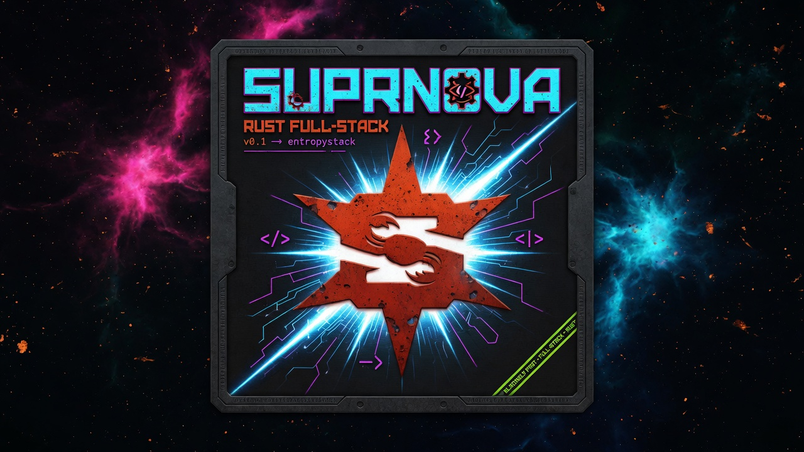

# Nebula

Nebula is [Suprnova](https://github.com/eas4ai/suprnova)'s Tier-1
starter kit - the Breeze equivalent. It gives a new app a complete,
production-shaped account story on day one:

- **Registration with email verification** - register, get a verification
  link by mail, and verified-only routes stay locked until it's clicked.
  The consume endpoint is public by design, so a link opened on a
  logged-out device still verifies.
- **Login with remember-me**, logout, and guest/auth/verified route gates.
- **Password reset** - request a link, set a new password. The request
  endpoint is anti-enumeration: it answers identically whether or not the
  address is registered.
- **Profile management** - update name/email (changing the email re-triggers
  verification), change password, delete the account.
- **A branded frontend** - Inertia 3 + Svelte 5 (runes) +
  [shadcn-svelte](https://www.shadcn-svelte.com), dark by default, with the
  Nebula icon set served at the web root.

The backend is Rust on Suprnova 4.1.0; the frontend is a Vite + Tailwind v4 SPA
bridged over Inertia, with server-side rendering for first visits. Everything below is wired and tested - clone it,
rename it, build your app on top.

### Part of the Suprnova kit family

Nebula is the auth-focused kit. Need more out of the box?
**[Pulsar](https://github.com/eas4ai/Pulsar)** is the full
product-site kit - marketing landing, docs pipeline, blog with RSS, member
community, and role-based access control - on Vue 3.5 + Vuetify. See every kit
in the [Suprnova manual](https://github.com/eas4ai/suprnova/blob/main/manual/starter-kits.md).

## Quickstart

You'll need Rust (stable), Node 20+, and the Suprnova CLI:

```bash
cargo install --git https://github.com/eas4ai/suprnova.git --tag v4.1.0 suprnova-cli
```

Then:

```bash
git clone <your-fork-of-this-kit> my-app
cd my-app
cp .env.example .env
suprnova serve
```

`suprnova serve` installs the frontend dependencies, starts the Rust
backend on `http://localhost:8080` (migrations run automatically against
the SQLite database) and Vite on `:5173`, and watches both. Open
**http://localhost:8080** - the page origin is always the Rust server;
Vite supplies JS/CSS and renders first visits on the server through
`frontend/src/ssr.ts`.

Prefer raw cargo? `cargo run --bin nebula` runs the backend
alone; pair it with `npm run dev` in `frontend/`.

### Your first registration

1. Visit `/register` and create an account. You'll land on the
   verify-email notice - the dashboard is gated until you verify.
2. The kit ships with `MAIL_DRIVER=log`, so the verification email is
   written to the server console instead of being sent. Look for the
   `mail (log driver): would send` line - its `text` field carries the
   full message, including the link:

   ```
   INFO ... mail (log driver): would send from=hello@nebula.test to=["you@example.com"]
        subject=Verify your email for Nebula html=… text=Hi there, Welcome to Nebula.
        Please confirm your email address by visiting:
        http://localhost:8080/verify-email/verify?token=…
   ```

3. Open that URL - you're verified and redirected to `/dashboard`.

Password reset works the same way: request a link on `/forgot-password`
and pull the reset URL out of the console.

## Mail

Development defaults (from `.env.example`):

```dotenv
MAIL_DRIVER=log
MAIL_FROM="hello@nebula.test"
```

The `log` driver prints every outgoing message (envelope + rendered text
body) to the console and discards it - zero setup, links included. To see
real emails in a real inbox during dev, run
[Mailpit](https://github.com/axllent/mailpit) and swap:

```dotenv
MAIL_DRIVER=smtp
MAIL_SMTP_HOST=localhost
MAIL_SMTP_PORT=1025
MAIL_SMTP_ENCRYPTION=none
```

For production, point the same SMTP variables at your provider (with
`MAIL_SMTP_USER` / `MAIL_SMTP_PASS` and
`MAIL_SMTP_ENCRYPTION=starttls` for a suitable relay on 587, or `tls` for
implicit TLS on 465), or use one of Suprnova's HTTP
transports (Postmark, SES, SendGrid, Mailgun, Resend) via `MAIL_DRIVER`.
`MAIL_FROM` is required whenever verification or reset mail is sent - the
flows fail fast on a missing sender rather than minting orphan tokens.

## APP_URL

Verification and reset links are built from `APP_URL`, not from the
incoming request - keep it in sync with how you actually reach the app
(default `http://localhost:8080`, matching `SERVER_PORT`). If you serve
the kit on a named TLS dev URL via `suprnova dev:tls`, set
`APP_URL=https://<name>.localhost` so emailed links land on the right
origin.

## Make it yours

**Brand assets.** The icon set lives in the top-level `public/` directory
(`favicon.ico`, the PNG sizes, `apple-touch-icon.png`,
`site.webmanifest`). Replace those files with your own and the whole app
follows - the tags that reference them are in
`templates/app.html`.

**Colors.** The UI is [shadcn-svelte](https://www.shadcn-svelte.com) on
OKLCH theme tokens in `frontend/src/app.css`: `:root` holds the light
theme and `.dark` the dark one. `--primary` is Nebula's cyan and
`--brand-accent` its red/orange; the rest are shadcn-svelte's `zinc`
defaults. Change a token there and every component follows. Keep each
`--primary` / `--primary-foreground` pair at 4.5:1 contrast or better.

**Components.** shadcn-svelte copies components into
`frontend/src/lib/components/ui/`; they are your code from then on. Add
one with `cd frontend && ./node_modules/.bin/shadcn-svelte add <name>`. The
CLI lists the packages a component needs under `devDependencies`; move them
to `dependencies`, because the SSR worker imports them at run time and a
production install may leave out dev packages.
Nebula's own pieces (layouts, `Head`, `SubmitButton`, the user menu, flash
toasts) live in `frontend/src/lib/layouts/` and `frontend/src/lib/components/`.
Sign-in pages (`pages/auth/*`) use the guest layout and every other page the
app layout; `frontend/src/main.ts` and `ssr.ts` pick it. A page that exports
its own `layout` from `<script module>` gets neither; that layout must render
`<ModeWatcher defaultMode="dark" disableHeadScriptInjection />` and
`<FlashToaster />`, or the page loses mode tracking and flash toasts.

**Forms.** Submit every form with `SubmitButton`, not a plain
`<Button type="submit">`. Pages are server-rendered, so a form shows before
the browser has run the page's code; a click or Enter in that gap submits the
form itself, the request misses the Inertia handler and the typed input is
lost. `SubmitButton` stays disabled until the page is ready, and while the
form is processing.

**Root-served static files.** Suprnova routes everything - there is no
implicit public directory, by design. The kit's pattern for files browsers
request at the web root is `src/controllers/static_files.rs`: a
`content_type` match that doubles as a whitelist, plus one explicit route
per asset in `src/routes.rs`. To serve a new root-level file, add one
match arm and one `get!` route. Anything not whitelisted is refused even
if a matching file exists under `public/`, so the handler can never be
pointed at an unexpected path. The same handler runs in dev and prod.

Built JS/CSS bundles use a separate `/assets/{*path}` route backed by
Suprnova's `StaticFiles` handler. Other root-level public files still
require the explicit whitelist and route described above.

**Head and meta.** First visits render through the root template
`templates/app.html`; put document-level head content there. It also holds
the script that sets light or dark mode before first paint, because it
receives the request's Content-Security-Policy nonce. Each page sets its
tab title with the `Head` component
(`frontend/src/lib/components/Head.svelte`), which reads `<Page> · Nebula`.

**Security headers.** Every response carries security headers, and HTML
responses carry a Content-Security-Policy with a fresh nonce
(`SECURITY_HEADERS=balanced`, the default). An inline `<script>` runs only
with that nonce; see the commented example in `templates/app.html`.

**Shared props.** `src/props/shared.rs` defines the `auth` prop every page
receives, and `src/props/flash.rs` the shape of `page.flash`. After changing
a struct that derives `InertiaProps`, run `suprnova generate-types` (`suprnova
serve` does it for you) to refresh `frontend/src/types/inertia-props.ts`.

## Markdown twins for crawlers

Pages render with JavaScript, so crawlers that do not run it (GPTBot,
ClaudeBot, PerplexityBot, `curl`) see an empty page. Nebula gives each
public prose page a Markdown copy, its twin, at the page's address plus
`.md`. The Home page's twin is `/index.html.md`. Twins are served by
[`suprnova-markdown`](https://github.com/eas4ai/suprnova-markdown) with
`X-Robots-Tag: noindex`, so search engines keep ranking the HTML page.
`/llms.txt` lists the twins, and each page names its twin in `<head>` with
`<link rel="alternate" type="text/markdown">`.

To add a page, add an entry to `PAGES` in `src/markdown.rs` and call
`Head::try_update(|head| head.link_tag(markdown::alternate(<path>)))` in
its handler. Edit `SUMMARY` there to describe your app in `/llms.txt`.

Both run before the session middleware, ahead of every route's sign-in
check. Follow these rules for every page and source you add:

- Return Markdown only for pages anyone may read, and decide that on each
  request from current data.
- Serve twins of pages that can stop being public (drafts, deleted or
  private pages) with `MarkdownMiddleware::new(..).max_age(0)`.
- A source that reads the database must limit its own time: twins run
  outside the 30-second request timeout.
- Keep both middlewares before `SessionMiddleware` in
  `src/bootstrap.rs`. Their responses are publicly cacheable, and a cache
  must never store a visitor's cookie with them.

Plugin v0.3.0 already sends only `GET` and `HEAD` to the source, and
answers a failed lookup with a plain 500 that is not cached.

## Production

Build the frontend with `cd frontend && npm run build && npm run build:ssr`,
then build the server from the repository root with
`cargo build --release`. Deploy `public/assets/` alongside the server
binary, and run the SSR worker as a second process from `frontend/`:
`node bootstrap/ssr/ssr.js` (it listens on `127.0.0.1:13714` and imports
packages from `frontend/node_modules`). Without the worker, pages render in
the browser.

Set `APP_ENV=production` (an unset `APP_ENV` is production too),
`APP_DEBUG=false`, a generated `APP_KEY`, the public `APP_URL`, and
`SESSION_SECURE=true`. Configure a delivering mail driver such as SMTP;
production boot rejects the development `log` driver.

Set `RATE_LIMIT_DRIVER=redis` and `RATE_LIMIT_REDIS_URL` to share
authentication quotas across replicas. Production boot rejects the
default in-memory limiter. For exactly one server process,
`RATE_LIMIT_ALLOW_MEMORY_IN_PRODUCTION=true` explicitly permits memory
limits, which reset on restart.

## Testing

```bash
cargo test
```

Two complementary suites cover the account flows end-to-end:

- **`tests/auth_flows.rs` (facade level)** exercises the flow *logic* -
  token mint/consume, verification stamping, password rotation,
  anti-enumeration - against a real in-memory database with the mail
  transport faked. Tokens are extracted from the captured mail bodies and
  assertions read the persisted rows back through the same user provider
  the app registers.
- **`tests/http_flows.rs` (request path)** drives the kit's *wiring* -
  the real route table behind the HTTP stack `bootstrap::try_register_http_stack()`
  installs, the guest/auth/verified middleware gates,
  session-cookie continuity, CSRF round-trips, and the real
  PATCH/PUT/DELETE verbs - through Suprnova's `handle_request` over a
  loopback socket, exactly like the framework's own integration
  harnesses.

A failure in the first suite points at flow logic; a failure in the
second points at HTTP wiring.

## Upgrading

For the Suprnova 4.1.0 upgrade (Nebula 3.0.0), follow [UPGRADE.md](UPGRADE.md), including production configuration and rollback steps.
